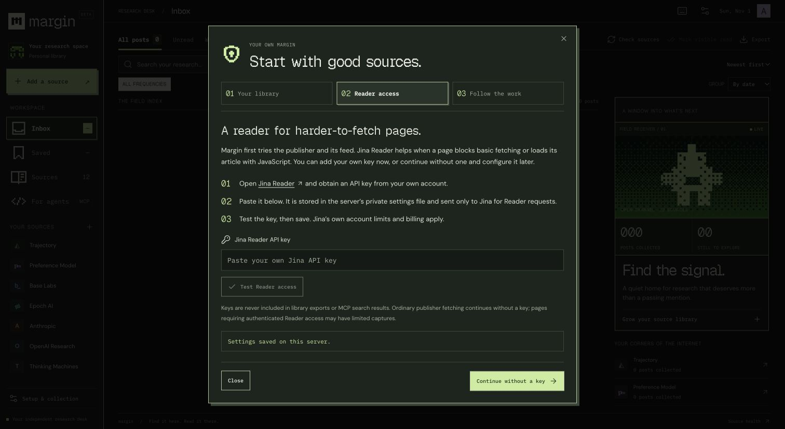

# Margin

A source-first research inbox for people and agents. Follow independent AI labs, collect the work that search engines and social feeds miss, preview the evidence, and read the original on its own site.

This is the self-hosted edition of Margin. It keeps the desktop inbox, pixel-and-dither design system, dark/light/system appearance, compact density, original-site previews, notes, source management, capture pipeline, and five agent tools. It runs on your own Node.js server and SQLite database, without a ChatGPT Sites account or Cloudflare account.

## Run it locally

Install **Node.js 24 or newer**, then run:

```sh
git clone https://github.com/CMLKevin/margin.git
cd margin
npm ci
npm run build
npm start
```

Open **http://localhost:3000**. A first-run guide explains the included sources, optionally configures and tests your Jina Reader key, and walks you through adding a normal blog URL. The database and settings are created automatically. No migration command, sign-in account, or external database is required.

For development, use `npm run dev` instead of building and starting. Both modes use the same storage and collector. Stop the server with Ctrl+C. Keep one server process per data directory.



## What ships by default

The packaged list was copied from the original owner's **active live Site subscriptions on November 1, 2026**, rather than the older local seed. It contains Trajectory, Preference Model, Base Labs, Epoch AI, Anthropic Research, OpenAI Research, Thinking Machines, Physical Intelligence, Goodfire Research, Prime Intellect, Together Research, Cognition Research, and the Anthropic Alignment Science Blog.

Both intentionally removed Hugging Face subscriptions are excluded. The software still supports ordinary Hugging Face blog links and tag-filtered links if you choose to add one yourself. See [sources/defaults.json](sources/defaults.json) for the exact URLs and [SOURCES.md](SOURCES.md) for clickable links.

Only publisher names, public URLs, and display colors are packaged. There are no copied research articles, personal notes, bookmarks, reading history, production database, Site credentials, or API keys. Each installation collects its own content. Defaults are applied once to a new database; restarting or upgrading does not restore sources you removed.

## Add your first blog

Click **Add a source** in the sidebar. Paste the publisher's ordinary blog or research page, such as `https://a-lab.example/blog`, and optionally give it a name. You do not need to find an XML feed. Margin checks advertised feeds, article cards, structured and hydration data, explicit pagination, and reader fallbacks.

Keep useful filters in the URL. For example, `https://a-lab.example/blog?tag=research` is treated as a filtered subscription. Pagination must retain its filter, and an unfiltered company RSS feed is not silently substituted. Hugging Face's filtered list has a dedicated compatibility path that excludes its unrelated community carousel.

After importing, open **Sources** to see the collection method, last check, and any capture issues. Sources can be renamed, paused, removed, and restored. Removing a source keeps its collected records and personal notes; saved posts remain available. **Check sources** refreshes on demand. The **Setup & collection** button reopens the first-run guide whenever you need it.

## Reader access and Jina

A Jina key is optional for ordinary public HTML and RSS. It is useful for publishers that block basic server requests or load article content with JavaScript. Open **Setup & collection → Reader access**, follow the link to [Jina Reader](https://jina.ai/reader/), paste your own key, and use **Test Reader access**. Save and continue when it succeeds. You may also skip this step and add a key later.

Keys are stored in the server's private `.margin/settings.json`, with restricted directory/file permissions. The API returns configuration status, not the key. A Reader key is sent only to Jina, never to the publisher or independent fallback provider. Library exports and MCP search results do not contain it. Your Jina account's limits and billing apply.

For environment-managed deployments, set `JINA_API_KEY` in `.env.local` or your hosting environment. It takes precedence over the stored key; the guide shows that it is environment-managed. `.env.example` lists supported settings. Environment files and the whole `.margin` directory are excluded from Git and Docker build context.

## Feature parity with the hosted edition

| Capability | Self-hosted behavior |
| --- | --- |
| Desktop inbox | The same source/date grouping, keyword/topic/capture filters, saved/unread/media views, and compact layout |
| Research previews | Reading estimates, image/media references, related posts, captured text, original URLs, embedded original-site preview, and notes |
| Source collection | The same RSS/Atom/JSON/RDF, HTML, structured/hydration, pagination, sitemap, Jina, and independent browser-reader fallback logic |
| Personal library | Persistent SQLite records, bookmarks, notes, read state, source pause/remove/restore, filtered JSON export, and keyboard shortcuts |
| Agent retrieval | The same five tools over authenticated Streamable HTTP, plus a local stdio bridge |
| Background checks | A server-owned scheduler, hourly by default, with a configurable interval and overlap protection |
| Privacy/access | Loopback binding by default; optional password-protected browser access and a separate private MCP bearer token |

The platform services are replaced by local equivalents, not left as stubs. The remaining difference is availability: local checks run while the server and machine are running. Closing the browser does not stop them. Shutting down or sleeping the computer does. On restart, overdue checks run again. An always-on machine or Docker deployment provides unattended operation.

Capture completeness still depends on the publisher and reader providers. Checks import up to 12 new posts per source and retry older incomplete captures; subsequent checks continue discovered backlogs. Per-post capture status and source health remain visible. Charts, videos, and interactive behavior are referenced, not claimed to have been visually interpreted. Original sites retain their layout and media.

## Connect an agent

Open **For agents** to try a real library query with source, date, topic, and capture filters, inspect results, and copy matching tool calls. **Copy authenticated connection** copies an HTTP configuration containing your instance's private bearer token. Treat that configuration as a password. Clients that support HTTP MCP can connect to `http://localhost:3000/mcp` with the copied `Authorization` header.

Desktop clients that use stdio can launch the included bridge. Replace the path below with the absolute path to your checkout:

```json
{
  "mcpServers": {
    "margin": {
      "command": "node",
      "args": ["/absolute/path/to/margin/scripts/mcp-stdio.mjs"]
    }
  }
}
```

The bridge reads the local private token itself. Keep the Margin server running. For a custom endpoint, set `MARGIN_MCP_URL` in the bridge's environment. If you use a different data directory or token, pass the same `MARGIN_DATA_DIR` or `MARGIN_MCP_TOKEN` to both processes. Relative paths in `.env.local` are resolved from the checkout.

The tools are `get_research_overview`, `search_research`, `get_research_post`, `list_research_sources`, and `refresh_research_sources`. Start with the overview for source IDs, topic counts, and health. Search with filters, then retrieve posts by ID. Publisher text is untrusted source material and is never an instruction to the agent. HTTP MCP requires a bearer token even when local browser access does not require a password.

## Docker and remote deployment

Docker keeps the server running when the browser closes and restarts it after container or host restarts. Choose a strong password, then run:

```sh
MARGIN_PASSWORD='choose-your-own-strong-password' docker compose up --build -d
```

Open `http://localhost:3000` and sign in with that password. Compose exposes the port only on the host's loopback interface and persists data in the `margin_data` named volume. You can configure Jina in the browser; no key is required in the Compose file. Docker tooling is optional and is not required for the ordinary Node.js installation.

For remote access, set `MARGIN_HOST=0.0.0.0`, `MARGIN_PASSWORD`, and `MARGIN_PUBLIC_URL=https://your-exact-host.example`. Put HTTPS in front of the server and preserve the Host header through your reverse proxy. The server refuses non-loopback binding without a password and rejects unexpected Host and Origin headers. Use a separate instance and data directory for each individual; this is a personal library, not a shared multi-account SaaS.

The app has a custom Node server for the scheduler and access controls. Start it with **npm start** or **npm run dev**, not `next start` or `next dev` directly. It is intended for a persistent Node process or container, not a stateless static host or a serverless function that is suspended after each request.

## Storage, backup, and export

The default data directory is `.margin/`. It contains `library.sqlite` (sources, articles, reading state, and job history), SQLite WAL files while running, and `settings.json` (private runtime settings). Set `MARGIN_DATA_DIR` for another location. Stop the server before copying the complete directory for a simple consistent backup, then restore it to resume your library. Keep that backup private because settings may contain credentials.

The inbox's **Export** action downloads only the currently filtered posts with provenance. The agent workspace can export the loaded library view. The UI loads up to 2,000 records; MCP search queries the stored database with up to 100 results per request. This matches the hosted edition's bounds. Database backups preserve the complete stored collection.

## Development and verification

```sh
npm run typecheck
npm test
npm run build
npm run test:integration
```

The integration test launches an isolated production instance, creates only temporary test data, and checks onboarding, authentication, origin validation, saved/read/notes persistence across restart, source removal/restoration, every MCP tool, the background scheduler, and stdio transport. Collector unit tests mock publishers and reader services, so CI does not need API keys or make paid Reader calls.

Core collection code lives in `lib/crawler.ts` and `lib/reader.ts`; library behavior is in `lib/library.ts`. The SQLite compatibility adapter is `lib/database.ts`. `server/main.mjs` owns the HTTP server, authentication, and scheduler. The first-run guide is `components/setup-guide.tsx`. The source defaults are applied to a new database once. No Sites plugin, private build helper, or local file outside this repository is needed to run or build it.

## License and credits

Margin's original code is MIT licensed. UI and font sources retain their own notices; see [THIRD_PARTY_UI.md](THIRD_PARTY_UI.md), [third-party/](third-party/), and [public/fonts/LICENSE.txt](public/fonts/LICENSE.txt). Publisher articles and media remain the property of their respective publishers and are not included in the repository.

## Publisher compatibility and topics

The [compatibility audit](docs/COMPATIBILITY.md) records the initial twelve publishers and the subsequent Alignment Science Blog check, discovery routes, sampled captures, and tested inbox/MCP behavior. Run `node scripts/audit-publishers.mjs` to repeat the read-only live check. It writes public publisher captures into ignored `outputs/compatibility/`; it does not change subscriptions or personal state. The optional local feature audit, `node scripts/audit-library-features.mjs`, is for a populated disposable local instance with its sources paused, and temporarily exercises save/read/notes and source removal/restoration there.

Topics share one twenty-category vocabulary across the inbox, previews, related posts, and MCP overview/search. Categories are grouped by methods, systems, capabilities, and applications/impact. Assignment weighs the title and publisher summary more strongly than repeated body terms, keeps the strongest four matches, and leaves weak matches unassigned. This is a transparent navigation aid rather than a claim that the publisher chose those labels. Existing libraries are reclassified automatically without changing saved/read state or notes. Topic counts respect the current source and inbox filters.

Collection repairs older extraction versions progressively, including previously accepted publisher error pages. HTML discovery recognizes explicit next-page and Load more links, keeps query/tag filters across pagination and redirects, and checks up to 25 linked pages. OpenAI research discovery supplements the real research index with only Research and Publication entries from its official news RSS. Text and media extraction remain bounded; publisher originals are the complete presentation.
